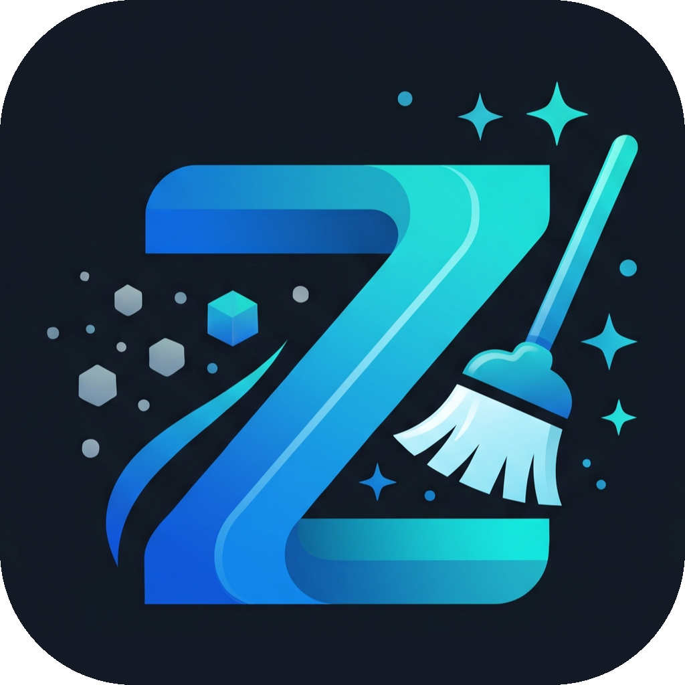
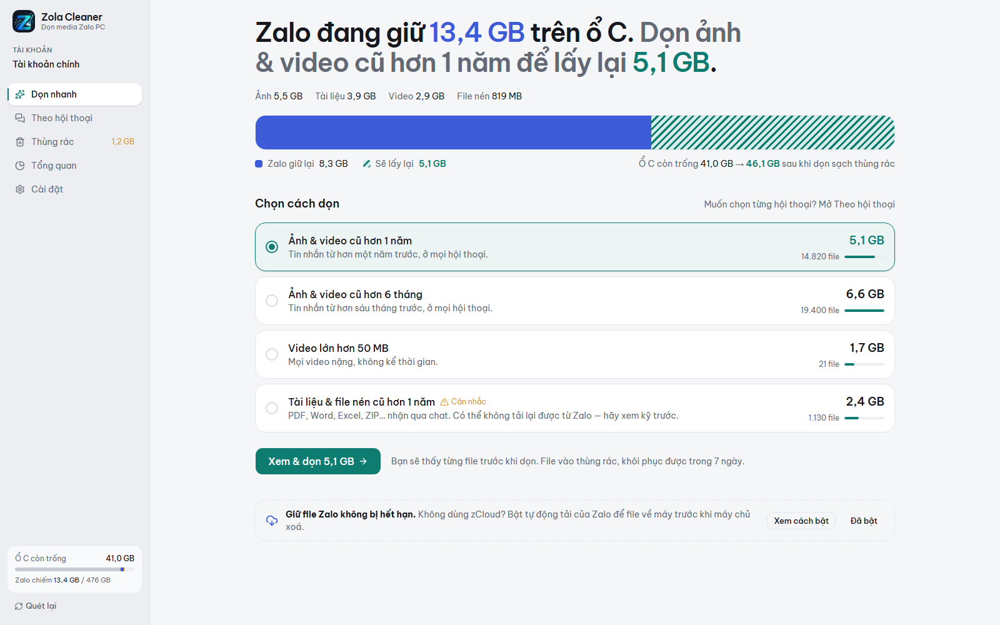
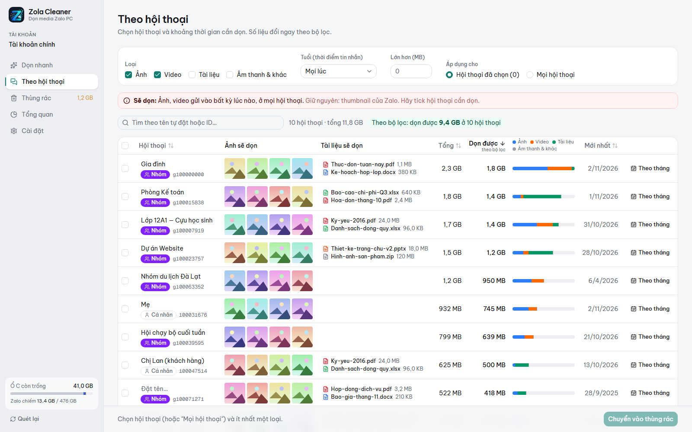
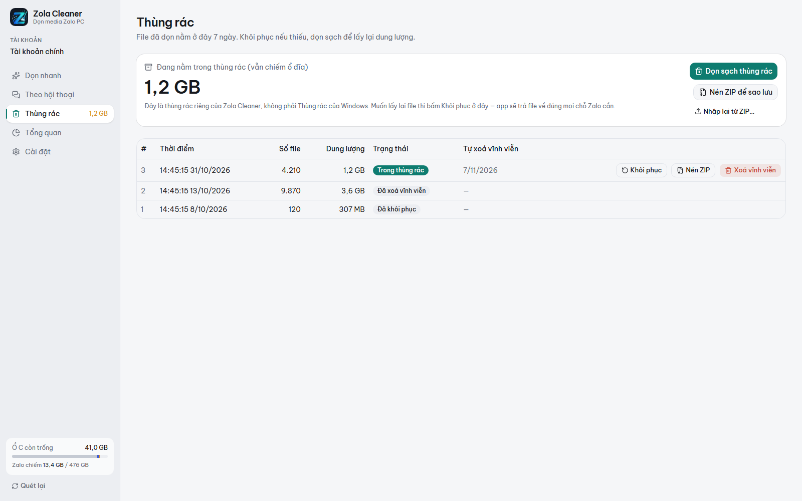
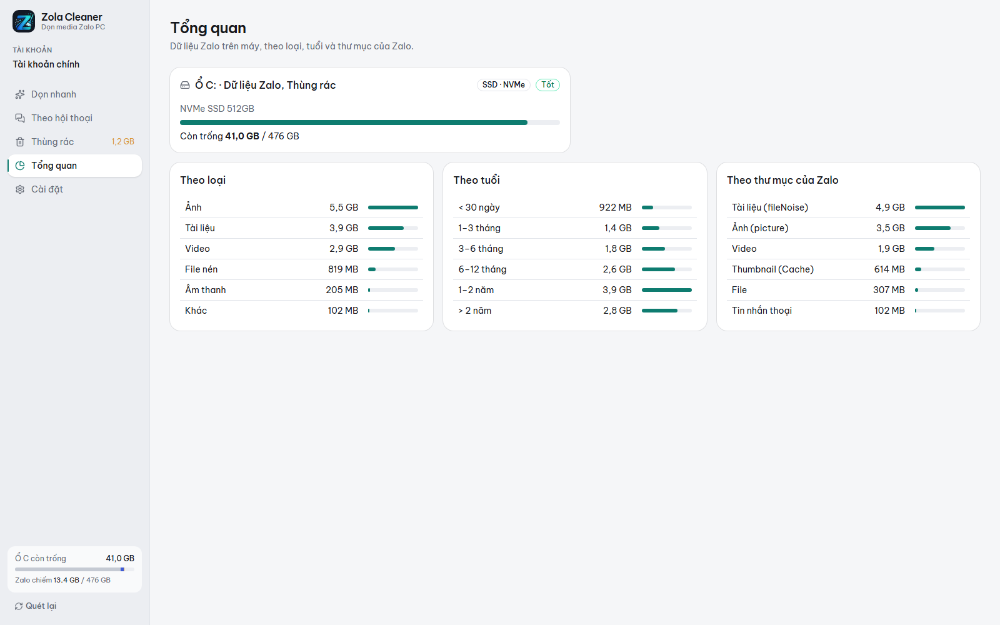

<p align="center">
  
</p>

<h1 align="center">Zola Cleaner</h1>

<p align="center">
  Clean up the photos, videos and documents that <b>Zalo PC</b> downloads to your computer: pick by conversation and age, preview every file, restore anytime.
  <br />
  <b>English</b> · <a href="README.vi.md">Tiếng Việt</a>
</p>

---

Zalo PC saves every photo, video and document you receive in chats to drive C, often tens of gigabytes. Zalo has no way to clean up by conversation or by age, so the drive keeps filling up.

Zola Cleaner shows how much space Zalo is using and which conversations use it. Then it cleans only the part you choose.

Curious where Zalo keeps your files and why they take so much space? See [**Where does Zalo PC keep your files?**](ZALO-STORAGE.md)

> The app's interface is in Vietnamese, since Zalo is used mostly in Vietnam.

<p align="center">
  
</p>

## Features

- **Quick clean**: one sentence tells you how much Zalo takes and how much you can get back, e.g. "Photos & videos older than 1 year → reclaim 4.4 GB".
- **By conversation**: pick individual chats or groups. Filter by kind (photos, videos, documents, archives…), age, size or file format (ZIP, RAR, PDF…), or use "this month and earlier".
- **Preview every file**: photos show as a grid and documents show their real names. Untick a file to keep it.
- **Its own trash**: cleaned files stay for 7 days and can be restored to their original places. You can also pack them into a ZIP for Drive or USB and import it back later.
- **Safe with how Zalo stores files**: one file can appear in several conversations as hardlinks. The app does not count it twice. It also does not remove a file that a conversation you didn't select still uses.
- Detects Zalo data moved to another drive, and supports several Zalo accounts on the same computer.

## Screenshots

The screenshots use made-up demo data: no real accounts, conversations or photos.

| By conversation | Trash |
|---|---|
|  |  |
| **Overview** | |
|  | |

## Install

1. Download `Zola.Cleaner_x.y.z_x64-setup.exe` from the [**Releases**](../../releases/latest) page.
2. Run the installer. It installs for the current user and doesn't need admin rights.
3. The app is **not code-signed yet**, so Windows may show "Windows protected your PC". Click **More info → Run anyway**.

The app tells you when a new version is out. Click **Cập nhật** (Update) to download and install it.

> Requirements: Windows 10/11 64-bit and Zalo PC 26 (data storage format 5.x) that has moved media to its new storage layout.
> If the Zalo folder layout on your computer differs from the one the app has verified, the app only lets you **view**, not clean.

## Using it safely

- **Quit Zalo completely before cleaning**: right-click the Zalo icon in the system tray → Quit (Thoát). The app reminds you if Zalo is still running.
- Cleaned photos and videos: Zalo can usually download them again when you open the chat, as long as the file is still on Zalo's servers.
- **Documents are never pre-selected.** Without zCloud, files stay on Zalo's servers for only a limited number of days. A cleaned document may be impossible to download again.
- Not using zCloud? In Zalo PC, turn on **Settings → Messages → Other settings → Auto-download photos/files/videos/voice messages under 30MB** so files reach your computer before they expire.
- Disk space is only actually freed when you **empty the trash** (Dọn sạch thùng rác), or after 7 days.

## Privacy

- The app only reads Zalo's media folder (`ZaloDownloads`). It **does not read your messages** or Zalo's database, and it does not control Zalo.
- No telemetry. The only network connection is asking GitHub whether a new version exists.
- Logs and structure reports are saved only to a file you choose, with account and conversation IDs removed.

## Development

Requirements: Windows, [Rust](https://rustup.rs) ≥ 1.95 (MSVC, with Visual Studio Build Tools), Node.js ≥ 22, pnpm 10 (`corepack enable`).

```bash
pnpm install
pnpm dev                     # run the app in dev mode (Tauri + Vite)
cargo test --workspace       # core tests on a fake Media Store with real hardlinks
cargo clippy --workspace --all-targets
pnpm typecheck
pnpm build                   # NSIS installer in target/release/bundle/nsis
pnpm --filter @zola-cleaner/desktop screenshots   # retake docs/screenshots with demo data (needs Chrome or Edge)
```

```
crates/core      Rust core: Zalo layout detection, scanning, classification, stats, trash, ZIP, document names
apps/desktop     Tauri v2 app: src-tauri (IPC commands) + src (React, Tailwind, shadcn/ui)
docs/            Plan, Zalo data layout, ADRs (in Vietnamese)
CONTEXT.md       Glossary used in code and UI (in Vietnamese)
```

Agent skills live in `.agents/skills` (pinned in `skills-lock.json`). `.claude/skills` holds relative symlinks to them so Claude Code loads them. On Windows, enable Developer Mode and run `git config --global core.symlinks true` before cloning. Otherwise Git checks the links out as plain text files.

Read first: [`CONTEXT.md`](CONTEXT.md) (glossary), [`docs/zalo-layout.md`](docs/zalo-layout.md) (how Zalo stores files), [`docs/adr/`](docs/adr) (major decisions).

Releasing is automatic. Commits follow [Conventional Commits](https://www.conventionalcommits.org). After CI passes on `main`, [semantic-release](https://semantic-release.gitbook.io) picks the next version from the commits since the last tag: `feat` bumps the minor version, `fix`/`perf` bump the patch version, and `BREAKING CHANGE` bumps the major version. `docs`, `ci`, `chore` and `refactor` don't release anything. GitHub Actions then tags the commit, builds and signs the installer, and publishes the release with generated notes. The version comes from the git tag, so don't edit `version` in the config files by hand.

When writing tests or docs, never use real Zalo uids or conversation IDs. Use fake numbers.

## Contact

- Bugs and feature requests: open an [issue](../../issues). If the app says your Zalo layout isn't supported, attach the structure report it exports. The report doesn't contain file names or IDs.
- Author: [@holedev](https://github.com/holedev)

## License

[MIT](LICENSE).
