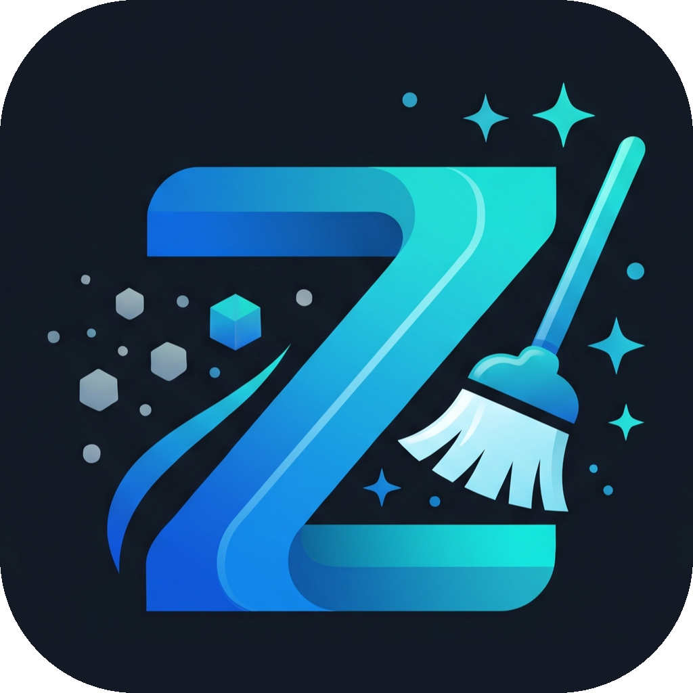
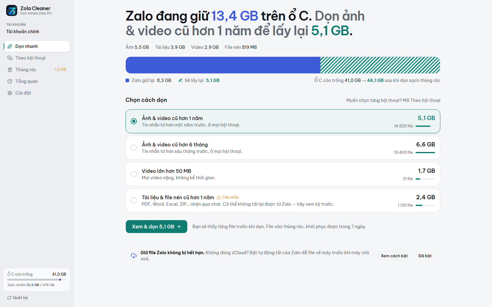
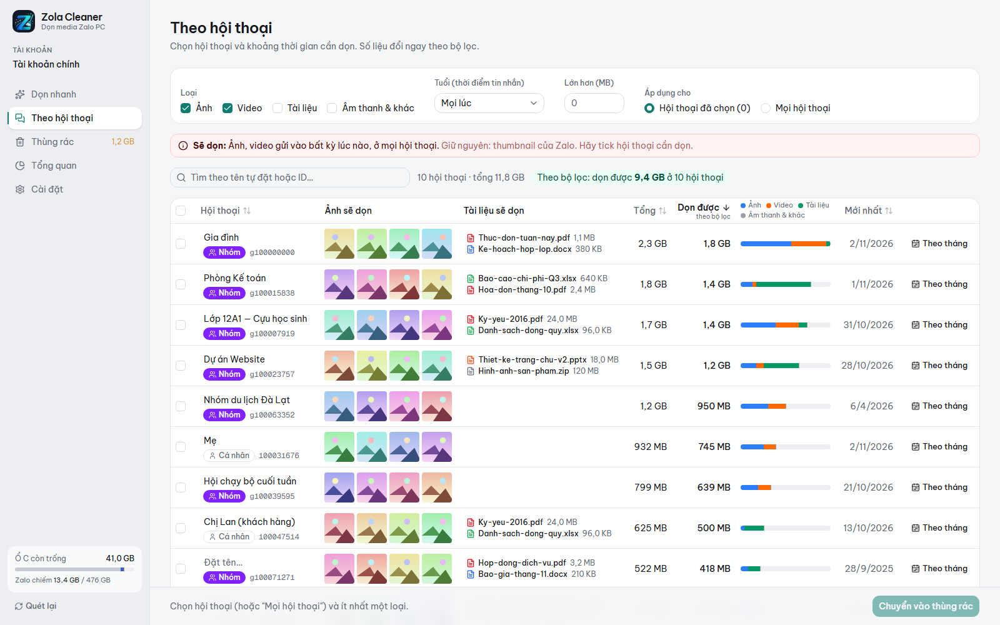
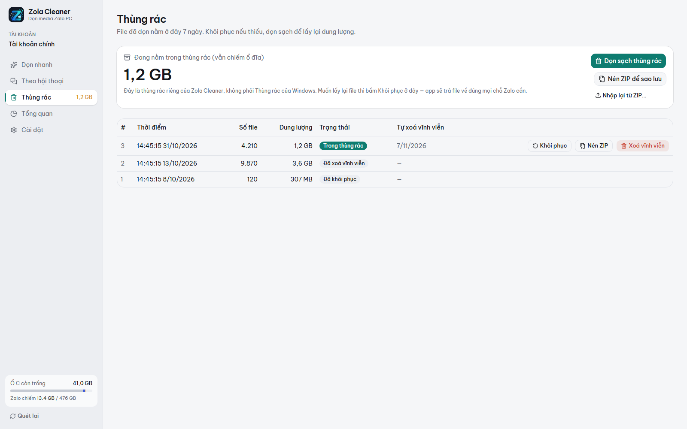
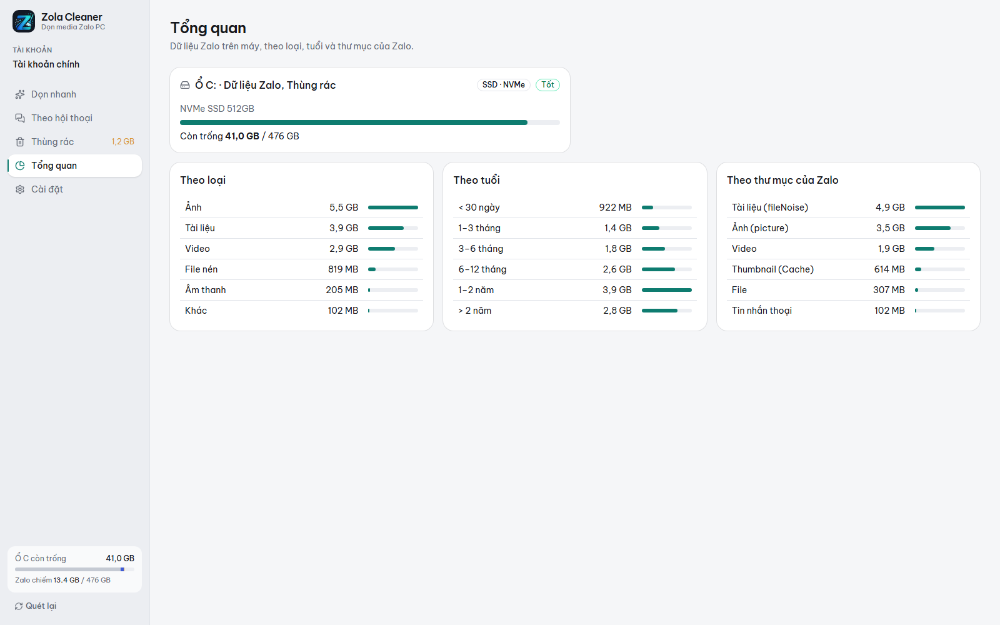

  

<h1 align="center">Zola Cleaner</h1>

  Dọn ảnh, video, tài liệu mà <b>Zalo PC</b> tự tải về máy — chọn theo hội thoại và thời gian, xem trước từng file, khôi phục được.
   
  <a href="https://holedev.github.io/zola-cleaner/"><b>Trang chủ</b></a> · <a href="../../releases/latest"><b>Tải về</b></a>
   
  <a href="README.md">English</a> · <b>Tiếng Việt</b>

---

Zalo PC lưu mọi ảnh, video, tài liệu nhận qua chat vào ổ C, thường lên tới hàng chục GB. Zalo không có cách dọn theo hội thoại hay theo thời gian, nên ổ đĩa cứ đầy dần.

Zola Cleaner cho bạn thấy Zalo đang giữ bao nhiêu, ở hội thoại nào, và dọn đúng phần bạn chọn.

Muốn biết Zalo cất file ở đâu và vì sao tốn chỗ? Xem [**Zalo PC lưu file của bạn ở đâu?**](ZALO-STORAGE.vi.md)

  

## Tính năng

- **Dọn nhanh**: một câu cho biết Zalo đang chiếm bao nhiêu và dọn được bao nhiêu, ví dụ "Ảnh & video cũ hơn 1 năm → lấy lại 4,4 GB".
- **Theo hội thoại**: chọn từng hội thoại hoặc nhóm, lọc theo loại (ảnh, video, tài liệu, file nén…), theo tuổi, theo kích thước, theo định dạng (ZIP, RAR, PDF…), hoặc "từ tháng này trở về trước".
- **Xem trước từng file**: ảnh hiện thành lưới, tài liệu kèm tên thật. Bỏ tick file nào thì file đó được giữ lại.
- **Thùng rác riêng**: file đã dọn được giữ 7 ngày và khôi phục đúng chỗ cũ. Có thể nén ZIP để cất lên Drive / USB rồi nhập lại sau.
- **An toàn với cách Zalo lưu file**: một file có thể nằm ở nhiều hội thoại (hardlink). App không đếm trùng và không dọn file còn dùng ở hội thoại bạn không chọn.
- Nhận ra dữ liệu Zalo đã chuyển sang ổ khác, và hỗ trợ nhiều tài khoản Zalo trên cùng máy.

## Ảnh giao diện

Ảnh chụp dùng dữ liệu demo bịa ra: không có tài khoản, hội thoại hay ảnh thật nào.

| Theo hội thoại | Thùng rác |
|---|---|
|  |  |
| **Tổng quan** | |
|  | |

## Cài đặt

1. Tải file `Zola.Cleaner_x.y.z_x64-setup.exe` ở trang [**Releases**](../../releases/latest).
2. Mở file cài. Cài theo người dùng hiện tại, không cần quyền quản trị.
3. App **chưa được ký số**, nên Windows có thể hiện "Windows protected your PC". Bấm **More info → Run anyway**.

App tự báo khi có bản mới. Bấm **Cập nhật** là tải và cài.

> Yêu cầu: Windows 10/11 64-bit, Zalo PC 26 (định dạng lưu dữ liệu 5.x), đã chuyển media sang cách lưu mới.
> Nếu cấu trúc thư mục Zalo trên máy bạn khác với cấu trúc app đã kiểm chứng, app chỉ cho **xem**, không dọn.

## Dùng thế nào cho an toàn

- **Thoát hẳn Zalo trước khi dọn**: chuột phải biểu tượng Zalo ở khay hệ thống → Thoát. App sẽ nhắc nếu Zalo còn chạy.
- Ảnh và video đã dọn: Zalo thường tải lại được khi bạn mở hội thoại, nếu file còn trên máy chủ Zalo.
- **Tài liệu không bao giờ được chọn sẵn**. Không có zCloud thì file chỉ nằm trên máy chủ Zalo một số ngày. Tài liệu đã dọn có thể không tải lại được nữa.
- Không dùng zCloud? Bật **Cài đặt → Tin nhắn → Cài đặt khác → Tự động tải trước Ảnh/File/Video/Tin nhắn thoại dưới 30MB** trong Zalo PC để file về máy trước khi hết hạn.
- Ổ đĩa chỉ thật sự trống ra khi bạn **Dọn sạch thùng rác**, hoặc sau 7 ngày.

## Quyền riêng tư

- App chỉ đọc thư mục media của Zalo (`ZaloDownloads`). App **không đọc tin nhắn**, không đọc CSDL của Zalo, và không điều khiển Zalo.
- Không có telemetry. Kết nối mạng duy nhất là hỏi GitHub xem có bản mới không.
- Nhật ký và báo cáo cấu trúc chỉ được lưu vào file bạn chọn, và đã lược bỏ ID tài khoản, ID hội thoại.

## Phát triển

Lõi viết bằng Rust, app dùng Tauri v2 + React. Cách cài đặt môi trường, các lệnh, cấu trúc thư mục, quy ước commit và cách phát hành nằm trong [**CONTRIBUTING.md**](CONTRIBUTING.md) (tiếng Anh).

## Liên hệ

- Báo lỗi, Zalo chưa được hỗ trợ, góp ý tính năng: chọn form phù hợp ở trang [tạo issue](../../issues/new/choose). Nếu app báo Zalo của bạn chưa được hỗ trợ, form sẽ hướng dẫn đính kèm báo cáo cấu trúc mà app xuất ra. Báo cáo này không chứa tên file hay ID.
- Lỗ hổng bảo mật: báo riêng tư, xem [SECURITY.md](SECURITY.md).
- Tác giả: [@holedev](https://github.com/holedev)

## Giấy phép

[MIT](LICENSE).
